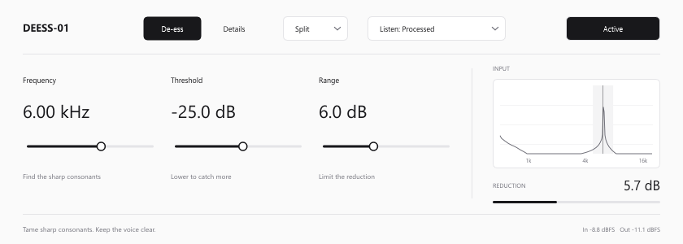

# DEESS-01

Деэссер для Windows x64 в формате VST3. Выбранная версия **0.2.0** с монохромным интерфейсом Spartan UI и экранами **De-ess / Details**.

## Скачать и установить

[Готовый VST3 для Windows](https://github.com/lowkGenuine/ds01/releases/tag/v0.2.0)

Распакуйте архив и скопируйте **всю папку `DEESS-01.vst3`** в `C:\Program Files\Common Files\VST3`. Затем выполните Rescan в настройках Plug-Ins Ableton Live.

## Возможности

- Frequency, Threshold и Range на основном экране.
- Split и Wide; прослушивание обработанного звука, частотной области и удалённого сигнала.
- Focus, Attack, Release, Ratio, Mix и Output на экране Details.
- 12 автоматизируемых параметров, сохранение состояния, моно и связанное стерео.
- Задержка обработки — 0 отсчётов.

[Руководство](README.ru.md) · [Сборка из исходников](BUILD.md) · [Проверки](VALIDATION.md)

Загрузка и обработка проверены в отдельном нативном VST3-хосте. Проверка в пользовательской сессии Ableton не выполнялась. Для сборки требуется JUCE 7.0.12; его условия находятся в [ThirdParty/JUCE-LICENSE.md](ThirdParty/JUCE-LICENSE.md).
