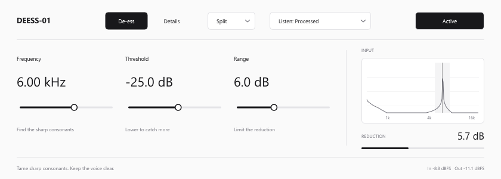

# DEESS-01

[English](README.md) · [Скачать VST3](https://github.com/lowkGenuine/ds01/releases) · [Руководство](docs/USER_GUIDE.ru.md)

[Поддержать автора](https://www.donationalerts.com/r/lesha_diabet_)

DEESS-01 — деэссер для резких согласных в вокале и речи. Выбери проблемную частоту, настрой момент срабатывания и ограничь глубину подавления. На основном экране монохромного интерфейса находятся Frequency, Threshold и Range; в Details — настройки времени и смешивания.

**Скачать готовый плагин:** [Windows x64 — v0.2.0](https://github.com/lowkGenuine/ds01/releases/download/v0.2.0/DEESS-01-0.2.0-win-vst3.zip).

**Code → Download ZIP**, **Source code** и `DEESS-01-0.2.0-source.zip` содержат исходники для разработчиков. Их нужно сначала скомпилировать. Для установки скачай файл с `win-vst3.zip` из [Releases](https://github.com/lowkGenuine/ds01/releases).

## Скачать и установить

Скачай `DEESS-01-0.2.0-win-vst3.zip` и распакуй архив. Скопируй **папку `DEESS-01.vst3` целиком** в `%CommonProgramFiles%\VST3`, обычно это `C:\Program Files\Common Files\VST3`. Сохрани вложенную папку `Contents`. Отдельного установщика нет; копирование в системную папку может потребовать права администратора.

В Ableton Live включи системную папку VST3 в Settings → Plug-Ins и сделай Rescan. Добавь **DEESS-01** из раздела Plug-Ins на аудиодорожку. Если плагин не появился, сверь настройки с [инструкцией Ableton для Windows](https://help.ableton.com/hc/en-us/articles/209071729-Using-VST-plug-ins-on-Windows).

Обновляй плагин при закрытой DAW. Устанавливай только одну копию с этим VST3-идентификатором. Этот релиз содержит Windows x64 VST3; сборок для macOS и Linux в нём нет.

[Скачать руководства на русском и английском для чтения без интернета](https://github.com/lowkGenuine/ds01/releases/download/v0.2.0/DEESS-01-0.2.0-guides-en-ru.zip).

## Возможности

- Одна динамическая полоса; Frequency, Threshold и Range на экране De-ess.
- Split для выбранной частотной области или Wide для всего голоса.
- Прослушивание обработанного звука, частотной области и удаляемого сигнала.
- Focus, Attack, Release, Ratio, Mix и Output на экране Details.
- Входной спектр, индикатор подавления и сообщение о перегрузке выхода.
- 12 автоматизируемых параметров, сохранение настроек, моно и связанное стерео.
- Заявляемая плагином задержка обработки — 0 отсчётов.

## Быстрая настройка

Зацикли фразу с резкими «с». Выбери **Listen: Sibilance** и настрой Frequency, чтобы найти их частотную область. Верни **Listen: Processed**, опускай Threshold до срабатывания на этих согласных, затем ограничь глубину через Range. Нажми **Active**, чтобы сравнить с исходным сигналом.

В [руководстве](docs/USER_GUIDE.ru.md) разобраны регуляторы, начальные значения и типичные проблемы. Интерфейс плагина — на английском; документация — на русском и английском.

## Задержка и статус

Версия 0.2.0 — рабочая сборка в разработке. Плагин сообщает **0 отсчётов буферной задержки**. Фильтры меняют фазу, а детектору и настройкам атаки/возврата требуется время реакции. Выходного лимитера нет.

Проверки охватывают загрузку VST3, сохранение настроек, моно/стерео, обход, создание редактора и обработку сигнала. Сравнение звучания и полноценные Ableton-проекты ещё требуют проверки. В этой версии нет пресетов, слотов A/B, внешнего сайдчейна, регулятора lookahead и распознавания фонем.

[Руководство](docs/USER_GUIDE.ru.md) · [Проверки](docs/VALIDATION.ru.md) · [Сборка](docs/BUILD.ru.md)

## Исходники и зависимости

Проект использует C++17 и JUCE 7.0.12. Условия зависимости приведены в [ThirdParty/JUCE-LICENSE.md](ThirdParty/JUCE-LICENSE.md). Отдельная лицензия для собственного кода проекта в репозитории пока не задана.
